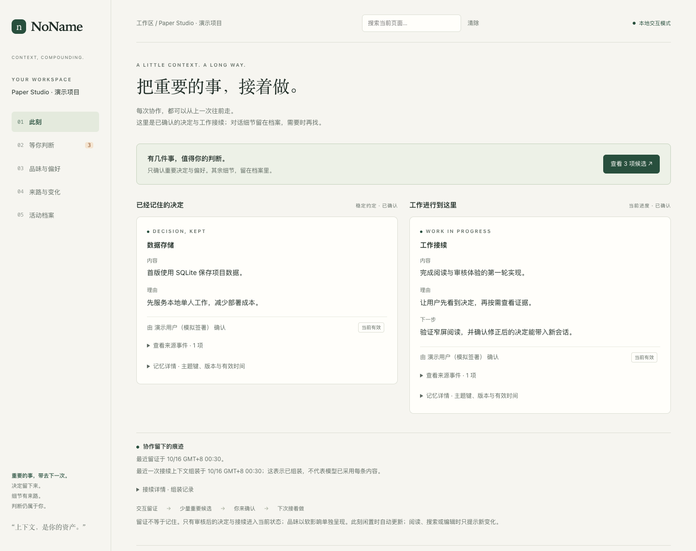

# NoName Agent Harness

**把上下文当作资产，让 agent 记得你为什么这样做。**

一次长任务，往往要经历多个聊天、模型和工具。NoName 为项目保留可追溯的工作记忆：已经决定了什么、理由是什么、下一步从哪里继续，以及你认可怎样的作品。新会话读到的是经过选择的上下文，重要判断由你确认。

> 正常工作时留下来路；值得长期保留时提出候选；下次继续时带上当前版本。

本地优先，Python 3.10+ 与 SQLite，记忆基座仅使用标准库。可在 **Codex** 中作为 memory sidecar 使用，也可通过 [DeepSeek Harness 插件](https://github.com/yuchenlogin/noname-dsh-plugin) 接入 DSH；已有 Python runtime 供开发者组合。



*真实界面，隔离演示数据。决定在前，来源与技术详情按需展开。*

## 它替你保留什么

| 工作中的时刻 | NoName 如何帮忙 |
|---|---|
| “为什么上次选 SQLite？” | 从当前决定回到理由和原始来源 |
| 换一个聊天继续做 | 组装项目决定、工作进度、偏好与相关证据 |
| “改用 PostgreSQL，需要多人协作了” | 对同一个主题提出修正；确认后当前记忆更新，旧版留在历史 |
| “这个表达对了，以后也这样” | 把具体例子与判断作为品味候选，由你明确确认 |
| “我想知道它到底记了什么” | 打开账本，看当前有效内容、待判断事项和完整来路 |

**记录过，和记住了，是两件事。** 对话与工具结果提供可查的证据；长期记忆保留决策、理由与来源。聊天里的一次猜测、普通成功输出或每一段闲聊，都不应该变成一条长期规则。品味是软性影响，不能冒充事实或覆盖你现在的指令。

## 先选一个入口

### 我在用 Codex

```sh
git clone https://github.com/yuchenlogin/NoNameAgentHarness.git
cd NoNameAgentHarness
python3 -m venv ~/.codex/noname/venv
~/.codex/noname/venv/bin/python -m noname_harness.codex_install
```

在 Codex CLI 中用 `/hooks` 检查并信任 NoName 的三个 handlers，然后进入你要接续的项目：

```sh
cd /path/to/your-project
~/.codex/bin/noname-codex init
~/.codex/bin/noname-codex status
```

重开或恢复项目聊天，正常完成一轮工作，再调用 `$noname-status` 查看本聊天的实际回执。已初始化的项目才会记录；初次安装不会导入旧聊天。

接着试一次有用的记忆：

1. 在聊天中说：`$noname-remember 记住当前决定：持久化使用 SQLite，因为首版只在本地运行。`
2. 调用 `$noname-ledger`，打开返回的本地网页，查看候选和来源并签署决定。
3. 在新聊天中调用 `$noname-recall`，确认这条决定及其理由出现在已批准记忆里。

到这一步，你已经完成了“提出 → 确认 → 接续”。日常无需每轮调用一串命令：hooks 自动留下输入与最终答复，在会话开始时提供上下文；agent 按 skill 的策展规则在重要阶段保存少量候选。审核只在你需要决定长期保留什么时出现。

完整的安装、信任、卸载和故障排查见 [Codex 部署指南](docs/codex-deployment.md)。安装会链接此源码目录，请保留仓库路径。

### 我在用 DeepSeek Harness

使用 [noname-dsh-plugin 的安装与上手指南](https://github.com/yuchenlogin/noname-dsh-plugin#readme)。插件按 DSH 工作区选择账本，提供证据记录、记忆候选、上下文包、品味与同一张可审核账本。宿主仍管理模型调用和工具执行。

### 我想先在本地看看

从本仓库根目录运行，无需模型 API key：

```sh
python3 -m venv .venv
.venv/bin/python -m noname_harness init --db .noname/harness.db --root .
.venv/bin/python -m noname_harness ledger-serve --db .noname/harness.db --background
```

打开命令返回的 `url`。空账本会说明如何开始；这条路径用于独立查看与开发，不会自动接入聊天。只需离线浏览时：

```sh
.venv/bin/python -m noname_harness ledger-html --db .noname/harness.db --out .noname/ledger.html
```

## 一张能读懂的账本

账本先回答“现在要知道什么”，再让你追问细节：

- **此刻**：当前决定和工作接续，先读内容与理由。
- **等你判断**：一件候选、一份来源、接受后会发生的变化，再签署。
- **品味与偏好**：你自己的判断与从模型表现中提出的候选，明确区分来源。
- **来路与变化**：旧版如何被修正，当前版本从哪里来。
- **活动档案**：原始事件与技术详情，需要时展开。

本地服务支持审核；离线 HTML 可浏览、检索和展开内容。两者来自同一套投影，历史不会因为界面变简洁而丢失。详见 [账本使用指南](docs/ledger.md)。

想先体验有内容的账本，可在本仓运行 `.venv/bin/python -m examples.ledger_demo`。它新建临时演示项目，包含决定、修正、品味与待审项；所有模拟签署均与自己的账本隔离。

## 为什么做 NoName

[第一次提交的愿景](docs/vision.md) 里有四个承诺：**上下文是资产，规范可以内化为记忆，品味属于你，界面是一张地图。** 好的 agent 不该让你重复交代自己，也不该把你困在过去的判断里。记忆存“决策 + 理由 + 指针”，档案保留细节；修正更新当前版本，来源持续可查。

NoName 的目标是让作品成为焦点，让管理记忆的动作退到背景。当前体验如何落实这些原则、哪些地方仍需手动判断，见 [体验模型与实测记录](docs/experience.md)。

## 当前边界

- Codex 接入自动捕获用户输入与最终答复；工具输出和中间消息不在其捕获范围。DSH 主要通过工具结果事件留证。两端均不等于全量聊天归档。
- hooks、skills 和工具提供接续与候选入口；没有默认的后台 LLM 自动提炼服务。是否提出候选仍依赖 agent 的工作流判断，长期状态仍需确认。
- 数据保存在项目 `.noname/`；建议加入 `.gitignore`。`user` 范围品味目前也在本项目账本内，不自动跨项目同步。
- 本地审核页仅监听 `127.0.0.1`；签署人是本机审计标签。远程宿主需端口转发，详见 [账本指南](docs/ledger.md#远程宿主与访问边界)。
- 独立 runtime 的真实模型适配器、计费、沙箱限制等开发边界见 [工程架构](docs/runtime-architecture.md)；接入插件不会接管宿主的执行权限。

## 深入与参与

| 想了解什么 | 从这里开始 |
|---|---|
| 产品初心 | [愿景](docs/vision.md) · [架构](docs/architecture.md) |
| 日常使用 | [Codex 部署](docs/codex-deployment.md) · [账本](docs/ledger.md) · [体验模型](docs/experience.md) |
| 数据与信任 | [记忆模型](docs/memory-model.md) · [品味与卡片](docs/taste-cards.md) |
| CLI 与开发 | [本地基座及命令](docs/prototype.md) · [运行时架构](docs/runtime-architecture.md) |
| 版本演进 | [CHANGELOG](CHANGELOG.md) |

开发验证可在自己的 Python 环境安装 `pytest` 后运行 `python -m pytest -q`。账本渲染、Codex 接入与 DSH 插件有各自的集成测试。反馈问题时，请提供使用入口、预期行为、实际结果及脱敏后的错误信息；不要公开完整的本地审核 URL 或个人账本。
